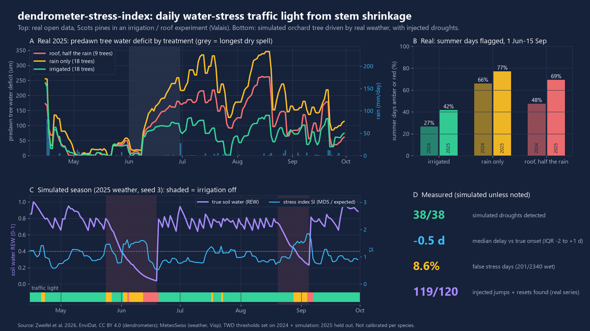
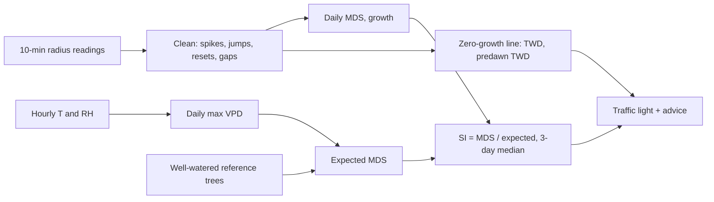

# dendrometer-stress-index

Turns point-dendrometer readings (stem or fruit radius every 10-15 min) into a daily water-stress traffic light: on simulated orchard seasons it caught 38 of 38 droughts within 2 days of onset, with 8.6% false stress days; on real irrigated vs rain-fed pines it flagged 42% vs 77% of summer days (2025).



## What it does
- Reads a CSV of dendrometer readings (long `time, tree, radius_um` or wide, one column per sensor).
- Cleans sensor faults: removes spikes, corrects jumps and logger resets (keeps the natural change across the step), fills gaps up to 1 h and leaves longer gaps empty.
- Computes per day: **MDS** (maximum daily shrinkage: morning maximum minus the following minimum), **growth** and **TWD** (tree water deficit, zero-growth-line method), including predawn TWD.
- Compares MDS with what a non-stressed tree would show today, either from **well-watered reference trees** (median MDS, scaled per tree on calibration days) or from a **VPD baseline** (expected MDS = a + b x daily max VPD, fitted on calibration days). The ratio is the signal intensity SI.
- Gives a traffic light per tree and day: green / amber (irrigate soon) / red (irrigate now) / grey (not enough data), from SI and from predawn TWD above its calibration level. Writes `daily_stress.csv`, `status.json` and a figure.
- Includes a seeded simulator (soil bucket, stomatal closure, stem capacitance, growth) driven by real hourly weather, with injected drought and irrigation events, to measure detection.

## Results
All numbers come from `python -m dendro_stress demo` (results in `results/metrics.json`).

**Simulated** (labelled simulated): 20 seasons (15 Apr-30 Sep), real MeteoSwiss Visp weather of 2024 and 2025, 10 seeds each, random tree parameters, 2 drought windows per season (irrigation off and rain excluded for 14-28 days). Truth: soil relative extractable water (REW) below 0.4 = stressed, above 0.6 = well watered. 38 of the 40 windows reached stress.

| Simulated | Reference trees | VPD baseline |
|---|---|---|
| Droughts detected | **38 / 38** | 36 / 38 |
| Median delay vs true onset (IQR) | -0.5 d (-2 to +1) | +1 d (0 to +2) |
| Worst delay | 2 d | 5 d |
| False stress days (well-watered days flagged) | 8.6% (201 / 2340) | **3.8%** (88 / 2340) |
| Back to green after irrigation resumes (median) | 1 d | 1 d |

A negative delay means the light turned amber while REW was still between 0.4 and 0.6.

**Real open data** (Pfynwald, Valais: Scots pines in a long-term irrigation experiment with roofs, 72 trees, 10-min, Apr-Oct 2024 and 2025; weather MeteoSwiss Visp). Calibration window 20 Apr-20 May each year; reference = median of the other irrigated trees. The TWD thresholds were set after looking at the simulation and 2024; **2025 is held out**.

| Real, 1 Jun-15 Sep | Irrigated | Rain only | Roof (rain cut ~50%, stated) |
|---|---|---|---|
| Trees analysed 2024 / 2025 | 16 / 16 | 15 / 17 | 8 / 9 |
| Summer days amber or red, 2024 | 27% | 66% | 48% |
| Summer days amber or red, 2025 (held out) | 42% | 77% | 69% |
| Median predawn TWD 2024 / 2025 (um) | 68 / 68 | 173 / 210 | 80 / 144 |
| MDS vs daily max VPD, rain-free days, r 2024 / 2025 | 0.63 / 0.46 | 0.74 / 0.49 | 0.44 / 0.19 |
| Predawn TWD vs days since rain >= 5 mm, Spearman 2024 / 2025 | 0.29 / 0.38 | 0.55 / 0.14 | 0.57 / 0.24 |
| TWD change over the longest dry spell, 2024 (22 Jul-11 Aug, 21 d) | -85 um | +217 um | +128 um |
| TWD change over the longest dry spell, 2025 (1-29 Jun, 29 d) | +101 um | +225 um | +163 um |

- The irrigated trees are the closest thing to a false-alarm check on real data: 27% and 42% of their summer days were still flagged. In these pines, predawn TWD builds up in summer even under irrigation; the thresholds are not tuned for that.
- With the VPD baseline instead of reference trees: irrigated 19% / 47%, rain only 53% / 88%, roof 35% / 84%.
- The TWD computed here matches the TWD published with the data: median r = 0.973 (2024) and 0.9998 (2025) over 72 trees, median absolute difference 4.1 and 0.27 um.

**Sensor faults** (known faults injected into clean series, then cleaned):

| | Real series (30 tree-seasons) | Simulated (10 seasons) |
|---|---|---|
| Jumps found | 90 / 90 | 30 / 30 |
| Resets found | 29 / 30 | 10 / 10 |
| Spikes found | 300 / 300 | 100 / 100 |
| False detections per 100 days | 0.97 | 0.65 |
| Daily MDS error, raw -> cleaned (um) | 8.7 -> 0.03 | 11.5 -> 0.03 |
| Predawn TWD error, raw -> cleaned (um) | 203 -> 3.0 | 204 -> 0.04 |

On the published (already quality-controlled) real series without injected faults, the cleaner still flagged 1.6 jumps and 0.5 spikes per 100 tree-days (113 series, 19 097 days).

## Quick start
```bash
uv venv .venv --python 3.12
uv pip install --python .venv/Scripts/python.exe -e ".[dev]"     # or: pip install -e ".[dev]"

python -m dendro_stress simulate --year 2025 --seed 1 --out sim.csv       # simulated orchard + reference tree
python -m dendro_stress run sim.csv --reference reference_tree --out out  # daily_stress.csv, status.json, figure

# real sample (6 pines, Jun-Aug 2025) with the VPD baseline from Visp weather
python -m dendro_stress run dendro_stress/data/sample_pfynwald_2025_jja.csv.gz \
    --weather dendro_stress/data/weather_visp_hourly.csv.gz --calib-start 2025-06-01 --out out_real

python -m dendro_stress demo      # all README numbers; downloads ~140 MB of open data into cache/ once (~4 min)
pytest -q -p no:asyncio
```
`status.json` gives one line per tree: last day, colour, advice, MDS, SI, predawn TWD, jumps fixed. Weather CSV columns: `time, t_air, rh` (optional `rain`), hourly, same clock as the dendrometer data.

## How it works

- MDS grows when a tree is short of water (it draws more on stem storage) but can fall again in severe drought, when the stem no longer refills. That is why predawn TWD (the overnight deficit that did not refill) is checked as well.
- Days with max VPD below 0.3 kPa give no SI (rain, fog: no shrink signal).
- Defaults: amber at SI >= 1.3 or TWD above calibration level >= 1.5 x calibration MDS; red at SI >= 1.6 or >= 3.0 x.
- A jump is a step inside one reading interval that is at least 12 robust sigmas and 5 times larger than the neighbouring changes, so fast but gradual swelling after rain or irrigation is not "corrected" away.

## Data sources
- Dendrometer data: Zweifel, R., Wilhelm, M., Hummel, D., Gisler, J., Rouholahnejad Freund, E., Etzold, S., Trotsiuk, V., Haeni, M., Rigling, A., Schaub, M. (2026). *Pfynwald VPDrought experiment stem radius changes (TreeNet)*. EnviDat. https://doi.org/10.16904/envidat.751. Licence **CC BY 4.0**. Files 2024 and 2025, 10-min, Scots pine (*Pinus sylvestris*), treatments control, irrigation, roof, and their humidified variants. A sample of 6 trees, June-August 2025, is committed in `dendro_stress/data/` (CC BY 4.0, same attribution). Treatment descriptions (rain halved under roofs, irrigation since 2003) are as stated by the data provider.
- Weather: MeteoSwiss SwissMetNet station Visp (VIS), hourly, open data (`ch.meteoschweiz.ogd-smn`, licence CC BY 4.0), April-October 2024 and 2025 committed in `dendro_stress/data/weather_visp_hourly.csv.gz`. Source: MeteoSwiss. The station is about 18 km from the trees.
- `python -m dendro_stress fetch` rebuilds the cache from these sources.

## What is not verified yet
- No own sensors: nothing here was measured with my hardware or in an orchard.
- The real data are forest Scots pines, not fruit trees or vines; no open orchard or vineyard dendrometer data with a clear licence was found. Orchard results are simulated only.
- Thresholds (SI 1.3 / 1.6, TWD 1.5 / 3.0) are not calibrated per species or cultivar; the TWD thresholds were chosen after seeing the 2024 pine data.
- On real irrigated pines 27-42% of summer days were still flagged, so as a false-alarm rate on real trees this is weak.
- The simulator is a simplified water-balance model written for this test; its detection numbers show the method works on its own assumptions, not in the field.
- Weather comes from a station 18 km away; VPD at the trees differs.
- The advice text is a signal, not an irrigation dose. No connection to a controller was tested.

## Licence
MIT, Copyright (c) 2026 Victor Bonilla. Data files keep their own licences (both CC BY 4.0: EnviDat dendrometer data, and MeteoSwiss weather with "Source: MeteoSwiss").
